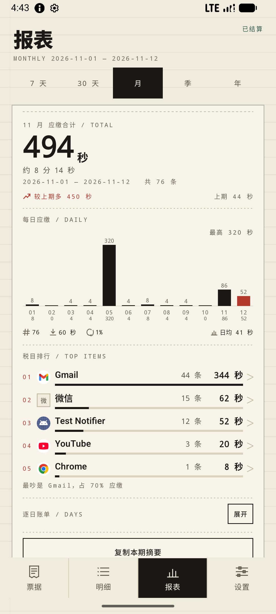
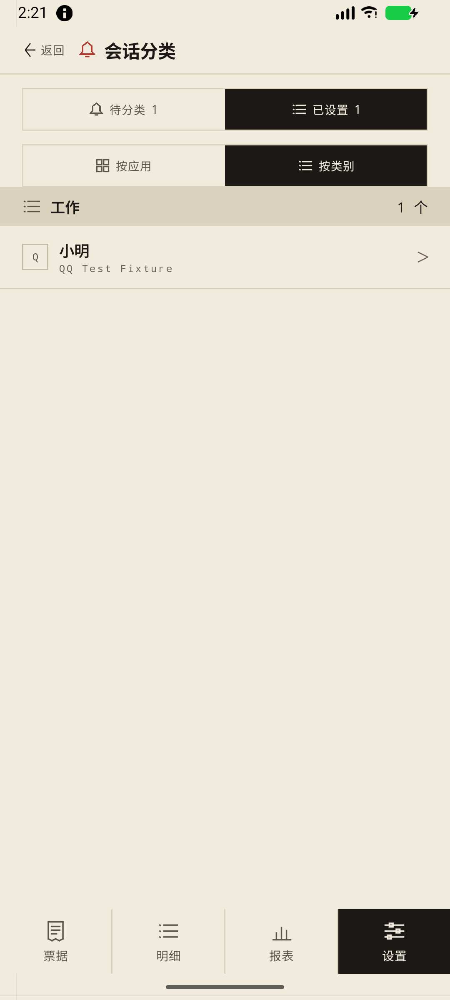
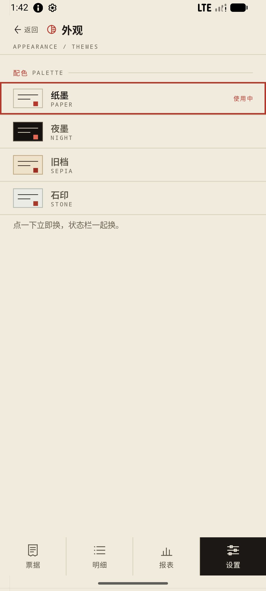

<div align="center">

# 打扰税 · QuietLedger

**把手机通知记成一张注意力账单。**

Android 8.0+ · 可离线使用 · MIT

[下载 APK](https://ql.130923.xyz/#install) · [GitHub Releases](https://github.com/lsqkk/QuietLedger-Android/releases) · [更新日志](CHANGELOG.md)

</div>

每条有效通知按规则折算成几秒「应缴」。每天的免税额用完后，票据会记下欠税。月底翻开报表，就能看见哪些 App 占走了最多注意力。

<div align="center">
  
  
  
</div>

## 能做什么

- **开一张每日税单**。看今天的应缴、免税额和结余，点开具体通知核对计价。
- **按会话计价**。为工作、家人、朋友和闲聊群设定不同规则，也能忽略整个应用。
- **翻看历史报表**。按 7 天、30 天、月、季、年查看变化，追到具体应用或日期。
- **把票据带到桌面**。小部件可看今日账单，快捷设置可开启静默，日报时间可自选。

## 开始使用

1. 下载 APK，按 Android 的系统提示完成安装。
2. 在首次引导中授予「通知使用权」，授权后的有效通知会开始记账。
3. 进入「设置 → 计价规则」调整单价和每日免税额。账单按北京时间分日。

两台设备共用账本时，在已登录的设备进入「设置 → 账户与设备」，生成一次性邀请码并在另一台设备输入。邀请码 10 分钟内可用一次。

## 数据与隐私

通知默认只在本机保存原文。云端同步默认开启，通过 HTTPS 上传应用、时间和计价标记等记录。关掉「设置 → 同步 → 云端同步」后，明细、票据、报表和日报仍可在本机使用。

点击「复制链接」或通过系统分享已结算的收据时，服务端才会生成公开链接。持链接的人能看到昵称和应用汇总。也可以直接分享完税证明图片。

## 从源码构建

Android 客户端使用 Kotlin 和 Jetpack Compose。安装 JDK 17 或 21、Gradle 8.13 和 Android SDK Platform 36 后，在仓库根目录运行：

```sh
gradle assembleDebug
```

调试 APK 位于 `app/build/outputs/apk/debug/app-debug.apk`。如需运行 Python + SQLite 后端及计价校验，见[开发与自托管](docs/DEVELOPMENT.md)。

欢迎通过 [Issues](https://github.com/lsqkk/QuietLedger-Android/issues) 提建议。提交界面截图前，请遮住通知原文和邀请码。计价定义见[税率规则](docs/TAX-RULES.md)。
